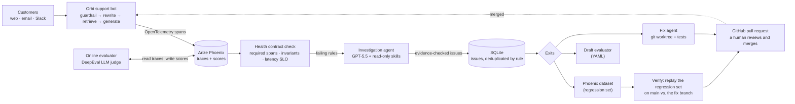

# Self-Improving Agent Loop

An AI support bot that gets watched, diagnosed and fixed by another AI agent, with a human
approving every change.

**Orbi** is a small RAG (retrieval-augmented generation) support bot for *Orbitask*, a made-up
project-management app. Every request it handles becomes an OpenTelemetry trace in
[Arize Phoenix](https://github.com/Arize-ai/phoenix). An online evaluator grades each answer
with [DeepEval](https://github.com/confident-ai/deepeval) LLM-judge metrics and attaches the
scores to the trace. A **health contract** (a short YAML file) says what "healthy" means, and
plain Python code checks every request against it. When a rule breaks, an **investigation
agent** reads the traces and the code, explains the root cause with evidence, and files an
issue. The loop then saves the failing requests as a regression dataset, drafts a new
evaluator, and has a **fix agent** open a pull request. Nothing is merged automatically.



<!-- RESULTS -->

## How it works

1. **The app (`support_bot/`).** A customer message enters through a channel (web, email or
   Slack). The input guardrail redacts card numbers and blocks prompt injection, the question
   is rewritten into a search query, the 20 help-center articles (84 chunks) are searched with
   OpenAI embeddings, and `gpt-4.1-mini` writes a structured answer with a confidence level and
   citations. Each step is an OpenTelemetry span with OpenInference attributes; OpenAI calls
   are traced automatically with token counts.
2. **Online evals (`evals/online_evaluator.py`).** A separate process reads recent traces and
   scores each answer with an LLM judge (`gpt-5-mini`):
   - *faithfulness*: the share of the answer's claims that the retrieved chunks support;
   - *contextual relevancy*: the share of retrieved text that is relevant (retrieval noise);
   - *context sufficiency*: a small custom G-Eval metric for "did retrieval find the answer at all?".

   The scores are written back to Phoenix as annotations on each request's root span.
3. **Health contract (`health_contract.yaml`, `loop/contract.py`).** Three kinds of rules:
   *required spans* (for example, every message must pass the input guardrail), *invariants*
   (for example, "high confidence requires good retrieval": when `answer.confidence == 'high'`,
   require `eval.context_sufficiency >= 0.5`), and a *latency SLO* (p95 under 5 seconds).
   Judge-scored rules have an error budget, because even a good judge is sometimes wrong.
   The checker is plain code, not an LLM: fast, free and repeatable.
4. **Investigation agent (`loop/investigate.py`, `loop/skills.py`).** A tool-calling loop on the
   OpenAI Responses API. Its *skills* are small read-only tools: query and group traces, open
   one trace, summarize evals, break down latency, map a span to the code that emits it, and
   read or search the code. It must cite real trace IDs and real code lines; the loop checks
   every citation and sends the submission back if anything doesn't hold up.
5. **Issue store (`loop/store.py`).** SQLite. Issues are deduplicated by the contract rule they
   break, not by the agent's wording, so re-runs update an issue instead of duplicating it.
   Issues resolve themselves when their rule passes again and reopen as regressions if it
   breaks later.
6. **Exits (`loop/exits.py`, `loop/fixer.py`).** For each issue: (a) the failing requests become a
   Phoenix dataset, (b) the agent's evaluator idea is written as a draft YAML evaluator, and
   (c) a fix agent edits an isolated git worktree. It has no shell and can only edit
   `support_bot/` and `tests/`, never the contract, the evaluators or the help-center facts.
   The loop runs the tests itself, commits, pushes and opens a PR. Two PRs never touch the same
   file at once: the second issue waits until the first fix is merged and re-measured.
7. **Verify (`loop/verify.py`).** Replays an issue's regression set on `main` and on the fix
   branch, scores both with the same judge and checks both against the same contract, giving
   measured before/after numbers for the PR.

## Design decisions

| Decision | Why |
|---|---|
| Deterministic contract checker; the LLM only explains | Counting violations is a job for code. The agent is used where judgment is needed: root cause, code location, fix. |
| Evidence is verified before an issue is saved | An agent can sound sure and still be wrong. Every cited trace must exist and must actually break the rule, and every cited code line must exist. |
| Dedup by broken rule, not by title | The agent words titles differently every run; the broken rule stays the same. |
| Error budgets on judge-scored rules | LLM judges have false alarms. A rule fails when its violation rate exceeds the budget, like an SRE error budget. |
| Judge model chosen by a calibration check | `gpt-4.1-mini` failed correct answers; `gpt-4.1` let made-up answers pass; `gpt-5-mini` caught 7 of 8 made-up answers. |
| Fix agent sandboxed by an allowlist | No shell, no git, no access to `.env`; edits only in `support_bot/` and `tests/`. It can't "fix" a rule by weakening the contract. |
| Human merges every PR | The loop proposes; people decide. |
| Instrumented with OpenTelemetry + OpenInference | Vendor-neutral: Phoenix could be swapped for another OpenTelemetry backend without touching the app. |

## Run it yourself

Requirements: Python 3.12 with [uv](https://docs.astral.sh/uv/), an OpenAI API key, and the
GitHub CLI (`gh`) if you want real pull requests.

```bash
cp .env.example .env                                       # add OPENAI_API_KEY
uv sync
uv run phoenix serve                                       # terminal 1: traces UI at http://localhost:6006
uv run python -m support_bot "How do I turn on 2FA?"       # ask the bot one question
uv run python -m scripts.seed_traffic --n 150              # realistic traffic across channels
uv run python -m evals.online_evaluator                    # score it with the LLM judge
uv run python -m loop check                                # test it against the health contract
uv run python -m loop investigate                          # the agent explains failing rules
uv run python -m loop issues                               # list issues; show one with: loop show 1
uv run python -m loop fix 1                                # dataset + evaluator draft + fix PR
uv run python -m loop verify 1                             # before/after on the regression set
uv run python -m pytest                                    # offline tests
```

## Project layout

```
support_bot/          the RAG bot that gets improved (kb/ holds the help-center articles)
evals/                online evaluator; custom/ holds evaluator drafts written by the loop
loop/                 contract checker, skills, agents, issue store, exits, verify, CLI
health_contract.yaml  what "healthy" means for the bot
scripts/              question bank and traffic seeder
tests/                offline tests (no network, no LLM calls)
docs/                 interview cheat sheet and resume bullets
```

## Limitations and next steps

- The judge was chosen with a small spot check, not a labeled calibration set. Next step:
  hand-label about 50 answers and measure judge agreement before trusting small changes.
- Traffic is seeded from a question bank, not real customers, and the knowledge base is small.
- One open issue per contract rule. Two different root causes behind the same rule are filed
  as one issue.
- Runs on demand from the CLI. A real deployment would run the evaluator continuously and the
  investigation on a schedule.

*Inspired by an agent-improvement-loop demo ("Signal") shown in a webinar. This is an
independent implementation with its own app, contract, skills and agents.*
